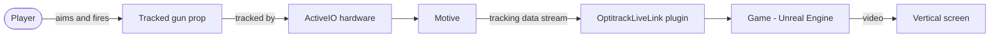

# Design

## Overview
"OptiTrack ActiveIO Game" is a working title for a small arcade-style demo game for
OptiTrack's ActiveIO motion tracking, intended for trade-show and in-office
demonstrations. The specific game concept
is not yet decided. The game will be built in Unreal Engine 5.8.1, with a
tracked gun prop aiming the weapon.

**Current state:** This repo contains documentation and repository
configuration. There is no Unreal project in the repo yet. OptiTrack's earlier
demo (UE 5.0) is a reference only, not a base.

## Architecture
**Planned, not yet implemented.** C4 level 1 (context):

- Game: the Unreal Engine 5.8.1 project.
- Motive: OptiTrack software that supplies tracking data.
- OptitrackLiveLink plugin: OptiTrack's Unreal plugin that brings tracking data
  into the game. Downloaded separately from OptiTrack's website.
- Other tracking components: TBD (see Open questions).

A container diagram will be added once the project structure exists.

## Interfaces
**Planned, not yet implemented.** Interface details are unconfirmed and are
tracked under Open questions.

- **Aiming input:** Tracking data from ActiveIO hardware, delivered to the game
  through Motive and the OptitrackLiveLink plugin. Data format and
  configuration: TBD.
- **Trigger input:** A trigger built into the gun prop, using GPIO/ActiveIO
  technology. Which hardware provides the signal and how it reaches the game: TBD.
- **Temporary input (prototype):** Mouse and keyboard stand in for the tracked
  gun until the hardware is integrated.

## Data
**Not yet decided.** No data model exists. Per docs/requirements.md, scores
reset each session and online leaderboards are a non-goal. What, if anything,
persists (e.g., settings) will be decided as gameplay takes shape.

## Deployment
**Status: planned, not yet agreed.** No deployable build exists yet.

**Production target (walking skeleton, week 10):** A packaged Windows build of
the game, published as a zip on this repo's GitHub Releases page and installed
and run on a device outside the team by an OptiTrack partner contact (a TA or
peer is the fallback if no partner is available). The repo and its Releases page
are owned by OptiTrack. The student team has write access and publishes releases.

**Who agreed:** Not yet agreed. Charlie will ask the OptiTrack project partners
on 2026-11-02 whether they will run the prototype in week 10. This section
will be updated with the outcome.

**Rollback (planned, untested):** If a release is bad, unpublish or delete it and
keep the previous release as the downloadable version.

## Open questions
- Does Motive run on the same PC as the game, and how is the plugin configured?
- Which hardware provides the trigger signal (GPIO, ActiveIO, or both), and how
  does it reach the game?
- What other components, besides Motive and the plugin, are needed?
- Who outside the team will run the week-10 build, and has OptiTrack agreed?
- Will we reuse any assets or code from OptiTrack's earlier demo (UE 5.0)? If so,
  does the inherited-codebase audit apply?

## Deferred decisions
- Final game concept and name (currently a working title).
- What data persists, if any.
- Container-level architecture, until a project exists in the repo.
- Settings, difficulty, and environment options (see docs/requirements.md).